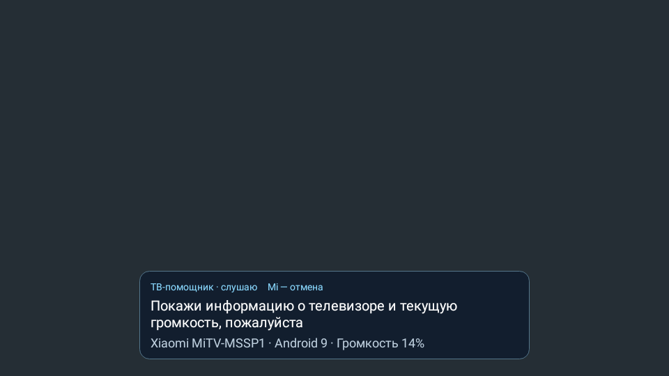

# Android TV Tools · программы для телевизора

Две небольшие программы для Android TV: голосовой помощник с погодой и автоматическая подсветка по солнцу. Разработаны и проверялись на **Xiaomi MiTV-MSSP1, Android TV 9**. Для повседневной работы ноутбук не нужен.

| Программа | Что делает | Скачать |
|---|---|---|
| **ТВ-помощник 0.2.4-xiaomi.12 / code23** | Кнопка Mi, маленькое окно, поиск в Wink и Zona, русская озвучка, управление приложениями и громкостью | [Комплект Windows](downloads/tv-assistant-windows-v23.zip?raw=true) · [APK](assistant/windows/tv-assistant.apk?raw=true) |
| **Погода** — часть помощника | Небольшая карточка над иконками CleanYourTV, прогноз по выбранному городу | Входит в APK помощника |
| **Сумерки ТВ 1.1** | Штатная подсветка по положению солнца: вечером 100 → 75 → 50 → 25 → 0%, утром обратно | [Комплект Windows](downloads/sunset-tv-windows-v1.1.zip?raw=true) · [APK](sunset-tv/windows/SunsetTV_1_1.apk?raw=true) |

Контрольные суммы: [downloads/SHA256SUMS.txt](downloads/SHA256SUMS.txt). Исходники и тесты доступны в папках [assistant](assistant) и [sunset-tv](sunset-tv).

## Быстрый запуск

1. Скачайте и полностью распакуйте нужный комплект Windows. Потребуется [Node.js 20+](https://nodejs.org/).
2. Включите отладку ADB на телевизоре, разрешите подключение компьютера. Укажите **свой** адрес `IP:порт` либо USB-серийный номер, когда установщик спросит. Адреса телевизора автора в комплекте нет.
3. Для помощника запустите **MI.cmd**, для подсветки — **INSTALL.cmd**. Установщики проверяют модель и поддерживаемые настройки до изменения телевизора. ADB при необходимости загружается с официального источника Google.
4. Помощник предложит один раз нажать Mi для назначения. Затем скажите **«Найди сериал Шерлок»**, **«Открой Винк»** или **«Сделай потише»**.
5. В «Сумерках ТВ» выберите свой город, проверьте ночной уровень на 10 секунд и подтвердите автоматику только после видимого изменения подсветки.

Можно задать адрес заранее в Windows: `set "TV_SERIAL=tv.example:5555"`. Вместо `tv.example` укажите адрес своего устройства. Для установки APK вручную и сборки смотрите инструкции компонентов.

## Возможности помощника

- Mi запускает пассивное мини-окно поверх приложения. Кнопка определяется по реальному нажатию, без фиксированного кода для всех пультов.
- Русский голосовой ввод через установленный сервис Android; русская озвучка через системный TTS. Приложение не включает в себя отдельные голосовые модели.
- Длинный ответ расширяет карточку; ↑/↓ листают большой текст, «Назад» закрывает, Mi начинает новую команду.
- Простой поиск фильма/сериала, запуск приложений, громкость и другие прямые команды работают локально без ИИ. Голосовой сервис Android может требовать Интернет.
- Общий поиск с главного экрана использует установленный Wink; приложение можно назвать явно. Поиск открывает выдачу, просмотр и покупки автоматически не запускаются.
- Для свободных составных команд доступны настраиваемые API-провайдеры. Нужны **свои** ключи; ключей или общего оплаченного аккаунта в проекте нет. Цены, доступность и лимиты определяет сервис; xKiro-путь перед генерацией проверяет нулевую цену выбранной модели.
- Погода Open-Meteo / MET Norway без ключа ИИ. Карточка рассчитана на [CleanYourTV](https://github.com/Gathin23/cleanyourtv); выберите свой город в настройках. Комнатная температура показывается только при наличии настоящего ambient temperature sensor, температура процессора не подставляется.

Пример мини-окна (демонстрационный рендер Android, не фотография телевизора):

## Совместимость и известные ограничения

| Часть | Подтверждено / ограничение |
|---|---|
| Windows-установщики | Проверяют Xiaomi MiTV-MSSP1 / Android 9; другие модели не объявляются совместимыми |
| Wink | Общий текстовый запрос сериала открыл выдачу, помощник прочитал реальные карточки; каталог зависит от приложения |
| Zona | Отдельный адаптер открыл выдачу с карточками. В code23 автоматическое чтение её выдачи ещё не подтверждает результаты и сообщает об этом |
| Mi и речь | На реальном пульте зафиксированы активация и распознанные фразы; точные тексты диагностикой не сохраняются |
| Озвучка | Русский Google TTS завершил контрольную фразу без ошибки сервиса; слышимость динамиков агентом не проверялась |
| Погода | Карточка проверялась на CleanYourTV; это не универсальный виджет любого штатного лаунчера |
| Сумерки | Прямое управление `Settings.Global.picture_backlight`, а не чёрный фильтр поверх экрана; нужна поддержка этой настройки прошивкой |
| Другие устройства / колонка | Маруся не подключена; проект не обещает универсальное управление всеми приложениями и умным домом |

Подробности: [помощник](assistant/README.md), [подсветка](sunset-tv/README.md), [проверки](docs/VALIDATION.md), [конфиденциальность](SECURITY.md).

## Происхождение и лицензия

Помощник основан на MIT-проекте **[mertmr/tv-assistant](https://github.com/mertmr/tv-assistant)**. Эта публикация — отдельный снимок с русским интерфейсом, мини-окном Mi, погодой и локальным поиском; она не является официальным релизом автора исходного проекта. Сохранены его лицензия и уведомления зависимостей: [assistant/LICENSE](assistant/LICENSE), [assistant/THIRD_PARTY_NOTICES.md](assistant/THIRD_PARTY_NOTICES.md).

«Сумерки ТВ» написаны для этой задачи. Названия аппаратных настроек изучались по [picture-settings-for-android-tv](https://github.com/alexrcq/picture-settings-for-android-tv); его код в APK не включён. Описание формул и дополнительные ссылки — в [sunset-tv/README.md](sunset-tv/README.md).

Код распространяется по MIT. Ключи подписи, API-ключи, личные журналы и домашние настройки сети не публикуются.
