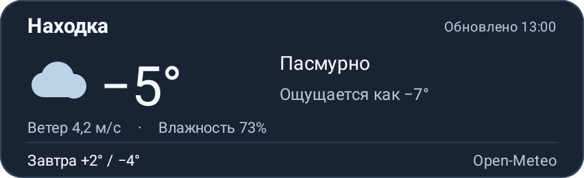

# ТВ-помощник для Xiaomi / Android TV

Версия **0.2.4-xiaomi.12-search-voice**, code23, пакет `dev.mert.tvassistant`. Основной источник: [mertmr/tv-assistant](https://github.com/mertmr/tv-assistant), MIT; базовый commit `3ab84f818b975c5d4104fc5a2beef6dd17874c10`.

В этой версии добавлены русский интерфейс, настраиваемая кнопка Mi, пассивная карточка поверх приложения, прокрутка ответа, русский TTS, погода и локальный поиск фильма/сериала. Это отдельная сборка, а не официальный выпуск исходного проекта.

## Установка на проверенную модель

Скачайте [комплект Windows](../downloads/tv-assistant-windows-v23.zip?raw=true), распакуйте целиком и запустите **MI.cmd**. Требуются Node.js 20+ и разрешённая отладка ADB на своём телевизоре. Укажите его адрес `IP:порт` либо серийный номер USB. Адрес можно задать переменной `TV_SERIAL` до запуска.

Комплект проверяет **MiTV-MSSP1, Android9/API28**, сверяет APK, устанавливает через `install -r`, сохраняет данные и существующие настройки других служб. Первая установка просит назначить Mi физическим нажатием; уже сохранённая кнопка при обновлении остаётся. В панели можно повторить обучение, проверить русский голос или открыть полное окно настроек.

Для ручной установки APK:

```sh
adb -s YOUR_DEVICE install -r windows/tv-assistant.apk
adb -s YOUR_DEVICE shell pm grant dev.mert.tvassistant android.permission.RECORD_AUDIO
adb -s YOUR_DEVICE shell am start -n dev.mert.tvassistant/.MainActivity
```

В настройках телевизора включите службу специальных возможностей **ТВ-помощник**. Она нужна для чтения/нажатия элементов, обработки Mi и мини-окна. Доступ к уведомлениям нужен для управления совместимыми медиаплеерами. Обычная кнопка Google не отключается. APK можно изучать на других устройствах, но совместимость их пультов, лаунчеров и прошивок этим релизом не подтверждена.

## Команды

| Фраза | Результат |
|---|---|
| «Найди сериал Шерлок» | Поиск в установленном Wink с главного экрана |
| «Найди Шерлок в Зоне» | Поиск в Zona через её собственную строку поиска |
| «Открой Винк» | Запуск установленного приложения |
| «Сделай потише» / «Громкость на 20 процентов» | Управление громкостью Android |
| «Пауза» / «Продолжи просмотр» | Действие в совместимой медиасессии |
| «Сколько времени» | Локальное время |

Составные команды могут потребовать выбранный API-провайдер. Настройте **свой** ключ в панели ПК или на ТВ. Ключ сохраняется в защищённом хранилище телевизора; в APK, командную строку ADB и архив он не включается. Провайдеры могут иметь региональные ограничения и менять тарифы. Для xKiro перед генерацией проверяется бесплатный доступ выбранной модели; платный вариант автоматически не подставляется.

## Мини-окно и речь

Распознавание использует установленный Android SpeechRecognizer на русском. Облачный сервис может требовать Интернет. Итоговая фраза исполняется один раз; промежуточный текст только показывается. Mi во время слушания/выполнения отменяет задачу, после ответа начинает новую. «Назад» закрывает карточку. Большой ответ листается ↑/↓, короткий не перехватывает стрелки приложения.

Ответ озвучивается русским системным TTS. Нужны установленные русские голосовые данные. Можно отключить озвучку в настройках; выбор сохраняется. Длинный ответ разбивается по лимиту TTS. Громкость не меняется, используется временный медиa-аудиофокус. При выключении экрана микрофон и озвучка останавливаются.

## Погода

Карточка включается в настройках погоды и показывается над иконками **CleanYourTV**; при переходе в приложение скрывается. Источники — MET Norway / Open-Meteo. Выберите город: изначально используется Находка. Координаты берутся из выбранного города, доступ к GPS не запрашивается.

Температура комнаты появляется только при доступном `TYPE_AMBIENT_TEMPERATURE`. На проверенном телевизоре такого датчика нет. Температура процессора/батареи не используется как комнатная.

Пример погодной карточки (демонстрационные данные):



## Известные ограничения

- Поиск не обходит все каталоги одновременно и не гарантирует наличие нужного сериала в подписке.
- Выдача Wink проверяется по запросу и видимым карточкам. Адаптер Zona открывает результаты, но code23 ещё не распознаёт её выдачу для автоматического текстового подтверждения.
- Код ввода Zona имеет строго ограниченное исключение: её поисковое поле на проверенной прошивке помечено password. В него записывается только название, старое содержимое не читается. Общий ввод паролей остаётся запрещён.
- Успешный TTS callback не доказывает слышимость конкретных динамиков/ресивера. Физические маршруты звука, Bluetooth-микрофон и доступность облачного распознавания зависят от телевизора.
- Маруся и управление внешними устройствами не реализованы.

## Сборка и проверки

Потребуются JDK17, Python3, Android SDK36 и Build Tools36.0.0. SDK укажите в `ANDROID_SDK_ROOT`.

```sh
bash build.sh
bash test-local.sh
python3 fetch-weather-test-sdk.py
cd tests/weather-android
mvn test
```

`build.sh` создаёт `dist/tv-assistant.apk`. Если локального ключа нет, создаётся собственный debug-ключ в `build/`; он не совпадает с ключом опубликованного APK. Для обновлений своих сборок сохраняйте один и тот же ключ приватно. Ключи подписи в репозитории отсутствуют.

PC-тесты: `node --test windows/*.test.cjs`. Четыре проверки Java/Node шифрования требуют предварительно собрать `tests/KeyProvisioningProbe.java` в `build/host-tests` и задать `TV_ASSISTANT_JAVA_CP`; без этого они пропускаются. Android-тесты используют Robolectric, не настоящую речь. Результаты опубликованной версии — [docs/VALIDATION.md](../docs/VALIDATION.md).
